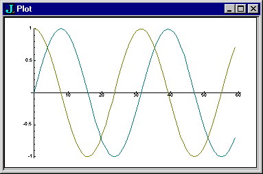
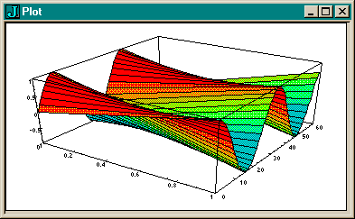

# 表格化副词

双子`v/`为动词`v`计算一个表格（函数表）。

```j
   a =. i. 5
   a +/ a	NB. addition table
0 1 2 3 4
1 2 3 4 5
2 3 4 5 6
3 4 5 6 7
4 5 6 7 8
   a */ a	NB. times table
0 0 0  0  0
0 1 2  3  4
0 2 4  6  8
0 3 6  9 12
0 4 8 12 16
  0 1 +/ 0 1	NB. + table on booleans
0 1
1 2
  0 1 +./ 0 1	NB. or
0 1
1 1
   0 1 +:/ 0 1	NB. not-or
1 0
0 0
   0 1 */ 0 1	NB. times
0 0
0 1
   0 1 *./ 0 1	NB. and
0 0
0 1
    0 1 *:/ 0 1	NB. not-and
1 1
1 0
```

派生动词`v/`左秩是`v`的左秩，右秩是`_`；它在左参数的每个单元格和整个右参数之间应用`v`。

```j
   additiontable =. +/
```

动词`additiontable`被定义为副词`/`以`+`为参数应用后的结果。
该定义与你在前一节中使用的`sumver`的定义相同。`addtiontable`表示在使用双子，
`summover`表示在使用单子。当然名字无法阻止对派生动词的误导使用。

```j
   a additiontable a
0 1 2 3 4
1 2 3 4 5
2 3 4 5 6
3 4 5 6 7
4 5 6 7 8
```

`+`的左秩是0，所以派生动词的秩是0，它的单元格参数是原子。
派生动词的右秩是`_`，它的单元格参数是整个右参数。从视觉上看，上面的工作原理如下：

```j
0 (first atom from left) + entire right   gives  0 1 2 3 4
1 (next atom from left)  + entire right   gives  1 2 3 4 5
2 (next atom from left)  + entire right   gives  2 3 4 5 6
3 (next atom from left)  + entire right   gives  3 4 5 6 7
4 (next atom from left)  + entire right   gives  4 5 6 7 9
```

下面是一个有趣的表格化用法，用于前面章节的绘图原语。
绘图工具将表格参数中的每一行绘制为单独的数据系列。

```j
   load 'plot'
   plot 1 2 o. / 0.2 * i.60   
```



```j
	'surface' plot 1 2 o. / 0.2 * i.60
```



左参数中的1用作`o.`的左参数，给出第一行的正弦值。左边参数中的2用作`o.`的做参数，给出了第二行的余弦值。

在上面的例子中，原始动词的左秩总是0，因此派生动词的左参数的单元格就是左参数的原子。让我们看一个例子，其中原始动词的左秩不是0。

```j
   f =. ,"1
```

动词`f`是左右秩分别为1的`, (append)`原语。

```j
   p=. 2 2 $'abcd'
   p
ab
cd
   q=.3 3$'ABCD'
   q
ABC
DAB
CDA

   p f/ q
abABC
abDAB
abCDA

cdABC
cdDAB
cdCDA
```

可视化：

```j
ab (1st list from left) , entire right   gives	abABC
			                        abDAB
			                        abCDA

cd (next list)    	, entire right   gives	cdABC
		                                cdDAB
		                                cdCDA
```