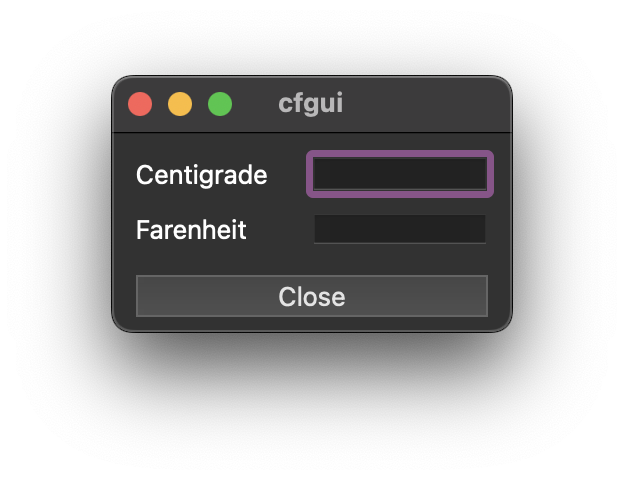

# 图形用户界面（第一部分）

现在，在被打包到图形用户界面（GUI）中之前，几乎没有一个编程任务算是完成了。

让我们为摄氏度和华氏度动词添加一个GUI。



构建表单和应用程序有许多步骤。你应该遵循的确切步骤包含在一系列缩进的项目中。
一般性讨论和背景资料以文本形式在这些项目间提供。

运行`cf.ijs`脚本，确保摄氏度和华氏度正常工作。

创建GUI的第一步是创建表单定义。表单定义存储在脚本文件中，就像所有其他定义一样。

创建一个新的脚本文件，将其保存为用户目录中的永久文件。表单的创建在JQt帮助菜单中的
[窗口驱动](https://code.jsoftware.com/wiki/Guides/Window_Driver)条目中有更详细的介绍，
如果你现在需要更多信息，请参考该条目。

- 用**File | New**创建一个新的脚本文件
- 将其保存在用户目录里的`cfgui.ijs`文件中

```j
NB. base form

CFGUI=: 0 : 0
pc cfgui;
pmove 100 200 200 100;
bin v;
 bin h;
  minwh 80 10;cc s1 static;cn "Centigrade";
  minwh 40 14;cc cid edit;
 bin z;
 bin h;
  minwh 80 10;cc s1 static;cn "Farenheit";
  minwh 40 14;cc fid edit;
 bin z;
bin z;
)

cfgui_run=: 3 : 0
wd CFGUI
NB. initialize form here
wd 'pshow;'
)

cfgui_close=: 3 : 0
wd'pclose'
)
```

所有与表单的交互都是通过`wd (Window Driver)`动词完成的。
`wd`参数总是一个以命令开头的字符串。字符串可以包含多个以分号分隔的命令。

名词`CFGUI`由连词`:`定义，与定义动词的方式类似。左参数`0`创建一个名词。
`CFGUI`被定义为接下来的字符行，直到只包含`)`的行结束。它包含将创建表单的命令。
现在不要担心细节，但大部分应该是好懂的。命令后跟参数，一行中的多个命令用`;`分隔。
`pc`命令是一个父创建（创建的窗口被当作父窗口）。下一行中的`pmove 100 200 200 100;`
将窗口放置在`x=100 y=200`的位置，且窗口大小为`width=200 height=100`。
`bin v;`创建垂直分组的组件，`bin h;`创建水平分组的组件。`bin z;`命令终止最近的`bin v;`或`bin h;`。
以`minwh`命令开头的行在表单上设置了一个矩形区域，后面跟着`cc`命令（创建组件），`cc`命令用于创建表单上的一个控件。

在`CFGUI`定义之后，你将看到一个名为`cfgui_run`的动词。这个动词忽略它的参数。它以`CFUGUI`作为参数执行`wd`动词。
这将创建表单，但不会显示表单。最后一个带有参数`pshow;`的`wd`命令将显示父（窗体）。

`cfgui_close`动词将使用`wd 'pclose'`命令关闭窗口。此时，`cfgui.ijs`脚本还没有运行，所以定义只是脚本文件中的文本，
还没有在J环境中定义。运行脚本之后，就可以运行应用程序了。

- 用**Run | Load Script**运行`cfgui.ijs`脚本
- 在**Term**窗口执行：`cfgui_run 0`

当你执行`cfgui_run 0`时，应该在屏幕的左上角看到表单。在控件中输入并按**Enter**没有效果，
因为你还没有连接到输入事件的代码。你可以通过执行`wd 'reset'`命令手动关闭表单，该命令关闭所有表单。

- 在**Term**窗口执行：`wd 'reset'`

当你在摄氏度编辑控件中输入一个值并按下**Enter**键时，就会触发一个事件。事件由发生该事件的窗体、控件以及事件类型来标识。
在编辑控件中按下**Enter**键属于按钮事件（在编辑字段中按下**Enter**键类似于按下按钮控件）。因此，这里关注的事件属于窗体
`cfgui`、控件`cid`，并且是一个按钮事件。当事件发生时，会执行一个名为事件处理程序的动词。所执行动词的名称由事件决定。
事件处理程序的名称由三部分组成：`formid_controlid_event`。因此，这里关注的事件处理程序名为`cfgui_cid_button`。
事件处理程序`cfgui_cid_button`应将`cid`编辑控件中的值转换为华氏温度，然后在`fid`编辑控件中显示该结果。

逆需要定义`cfgui_cid_button`。当事件处理程序被执行时，名词`cid`将自动具有编辑字段内容的值。
值是一个字符串，你需要用`".`原语把它转换成一个数字。

```j
t =. 0 ". cid
```

接下来就是把摄氏度转换成华氏度。

```j
t =. fahrenheit t
```

名词`t`是你希望在`fid`编辑控件中显示的数字。必须将数字转换为字符串，才能在编辑字段中显示。
使用`": (format)`来转换。

```j
t =. ": t
```

最后，将文本字符串写入`fid`编辑字段。

```j
wd 'set fid text' , t
```

`wd`参数有一个命令`set`、要设置的控件标志`fid`、要设置的属性`text`，`t`包含要设置的数据。

将这些句子添加到`cfgui.ijs`脚本中的`cfgui_cid_button`定义里。

```j
cfgui_cid_button=: 3 : 0
t =. 0 ". cid
t =. fahrenheit t
t =. ": t
wd 'set fid text', t
)
```

为了保持表单的自成体系，我们将在脚本中添加华氏度和摄氏度的定义，以便执行计算。注意在脚本中输入正确的内容。

```j
fahrenheit =: 3 : 0
t1 =. y * 9
t2 =. t1 % 5
t3 =. t2 + 32
)

centigrade =: 3 : 0
t1 =. y - 32
t2 =. t1 * 5
t3 =. t2 % 9
)
```

此时，`cfgui.ijs`脚本没有运行，所以更改只是脚本文件中的文本。

- 使用**Run | Load script**运行脚本
- 在**Term**窗口中运行应用程序：cfgui_run 0

你应该会在屏幕中央看到表单。在摄氏度区域输入一个数字并按回车键。
华氏度应该显示在它的字段中。

如果你输入华氏度并按回车键，什么也不会发生。这是因为你没有为该事件提供处理程序。
如果未定义事件处理程序谓词，则忽略该事件。`cfgui_fid_button`的定义类似于`cfgui_cid_button`。

```j
cfgui_fid_button=: 3 : 0
t =. 0 ". fid
t =. centigrade t
wd'set cid text', ": t
)
```

- 将`cfgui_fid_button`的定义添加到cfgui.ijs中
- 使用**Run | Load Script**运行脚本
- 在**Term**窗口执行：cfgui_run 0

现在，当你在华氏度字段中键入一个值并按回车键时，它将被转换并显示在摄氏度字段中。

`cfgui_close`动词在单击表单上的关闭框时处理事件。`wd 'pclose' (parent close)`命令关闭表单。
但是作为实践，你应该添加一个标题为`Close`的按钮控件，该按钮控件也将关闭窗体。

- 在**Term**窗口中输入：wd ‘reset’
- 在`CFGUI`定义中最后两个bin z之间添加行`minwh 80 30;cc close button;cn "Close";`

```j
pc cfgui;
pmove 100 100 200 100;
bin v;
 bin h;
  minwh 80 10;cc s1 static;cn "Centigrade";
  minwh 40 14;cc cid edit;
 bin z;
 bin h;
  minwh 80 10;cc s1 static;cn "Farenheit";
  minwh 40 14;cc fid edit;
 bin z;
 minwh 80 30;cc close button;cn "Close";
bin z;
)
```
- 定义`cfgui_close_button`
```j
cfgui_close_button=: 3 : 0
wd'pclose;'
)
```
- 使用**Run | Load Script**运行脚本
- 在**Term**窗口中运行：cfgui_run 0

当你厌倦了该程序时，可以按**Close**按钮关闭表单。

恭喜！你已经用J编写了一个GUI应用程序。
它很简单，虽然有一些粗糙，但是你已经跨过了很高的障碍。