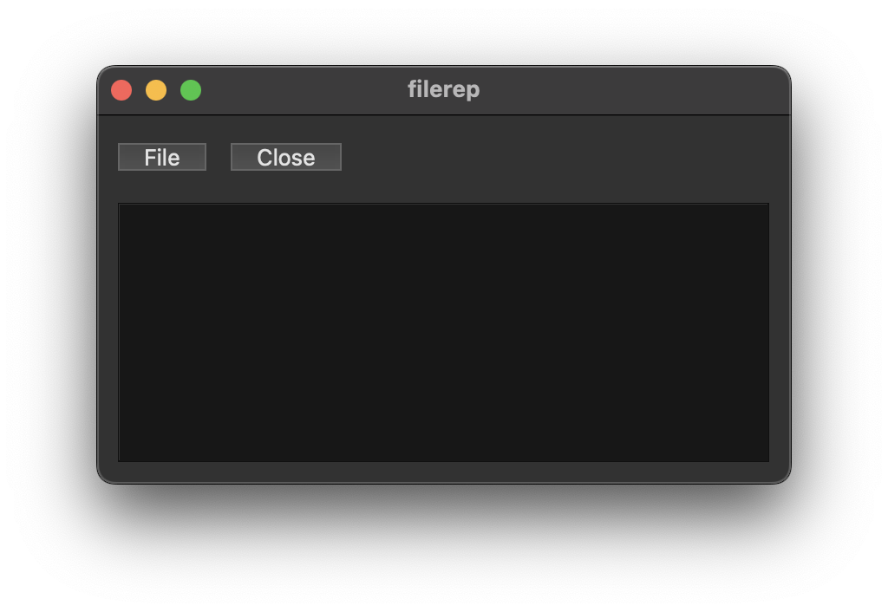

# 图形用户界面（第二部分）

应用程序的GUI部分规定如下：

表单应该有一个**File**按钮、一个**Close**按钮和一个多行编辑控件。
**File**按钮允许用户选择文本文件。所选文本文件的报告将显示在多行编辑控件中。

你需要设计表单并定义事件处理程序。

在本例中，GUI定义将使用与前一节的`DP`定义不同的脚本，以保持这两个部分之间的清晰区别。
创建一个新的脚本文件并将其保存为`jpath '~user\textgui.ijs'`。打开脚本并设计表单。
**File**按钮的标识符应该是`file`， **Close**按钮的标识符应该是`close`。
新建控件命令创建的大型编辑控件是一个多行编辑控件，需要使用`editm`类。
多行编辑控件的标识符应该是`editm`（默认值是`cceditm`，因此必须指定`editm`）。表单应该如下所示：

你需要为**Close**和**File**按钮添加事件处理程序。事件处理程序的代码如下清单所示。
该清单应该类似于最终的`cfgui.ijs`脚本。

```j
FILEREP=: noun define
pc filerep;
pmove 100 200 400 100;
bin v;
bin h;
minwh 34 25;cc file button;cn "File";
minwh 34 25;cc close button;cn "Close";
bin s;
bin z;
minwh 150 150;cc editm editm;set editm scroll min;
bin z;
)

filerep_run=: 3 : 0
wd FILEREP
NB. initialize form here
wd 'pshow;'
)

filerep_close=: 3 : 0
wd'pclose'
)

filerep_close_button=: 3 : 0
wd'pclose'
)

filerep_file_button=: 3 : 0
p =. '"" "" "Text (*.txt)"'
fn =. }: wd 'mb open ' , p
if. 0 ~: #fn do.
 wd 'set editm text *' , report fn end.
)
```

唯一新的部分是`bin;`，它在水平`bin`中提供了一个间隔符，
并使用`wd 'mopen'`命令。`wd 'mopen'`命令打开一个普通的文件打开对话框，
允许用户选择一个文件。局部变量`p`包含`mbopen`命令的参数。这些参数至关重要，必须正确定义。
如果你想了解更多关于`mopen`参数的信息，可以在JQt环境的帮助菜单中的J在线文档中查看
[窗口驱动程序的消息框部分](https://code.jsoftware.com/wiki/Guides/Window_Driver/MessageBox)。
事实证明，必须使用`}:`来去掉`mb open`附加到路径的尾部换行符。

`mbopen`命令的结果为用户选择的文件名。如果用户在打开对话框中按下取消，结果将是一个空字符串，
没有什么可做的。如果`fn`不为空，则执行`report fn`以生成报告并将其设置到`editm`控件中。

行`wd 'set editm text *' , report fn end.`中的`*`表示字符串的其余部分（`report fn`的结果）
是要设置到`editm`多行编辑控件中的数据。

运行`textdp.ijs`和`textgui.ijs`，如果是一个新的会话，`load 'files'`，然后启动应用程序。

```j
   filerep_run 0
```



按**File**按钮，选择你的`jpath '~user\text.txt'`文件，然后按**OK**。也可以尝试其他文本文件。

该应用程序使用来自三个脚本的定义：`textdp.ijs`, `textgui.ijs`和`andfiles.ijs`。
那么创建一个脚本来加载所有脚本，然后运行应用程序是有意义的。

创建一个新的脚本文件，保存为`jpath '~user\textapp.ijs`，并添加以下行。
`jpath`是一个动词，它提供用户文件夹的完整路径。

```j
NB. this application reports file character frequencies
load 'files'	
0!:0 < jpath '~user\textdp.ijs'
0!:0 < jpath '~user\textgui.ijs'
filerep_run 0
```

保存脚本。关闭J并重新启动它以获得一个干净的环境。使用`open jpath '~user\textapp.ijs'`打开文件。
通过使用**Run | Load Script**运行脚本来运行应用程序。